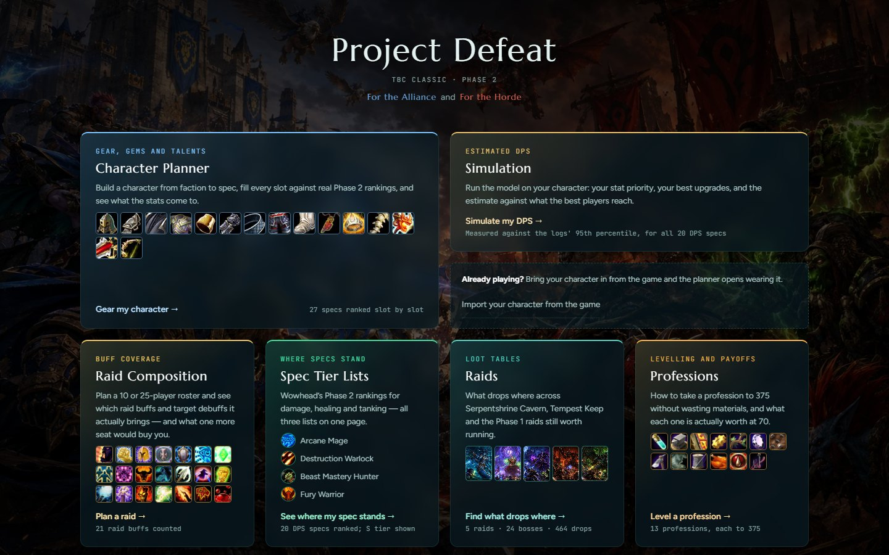
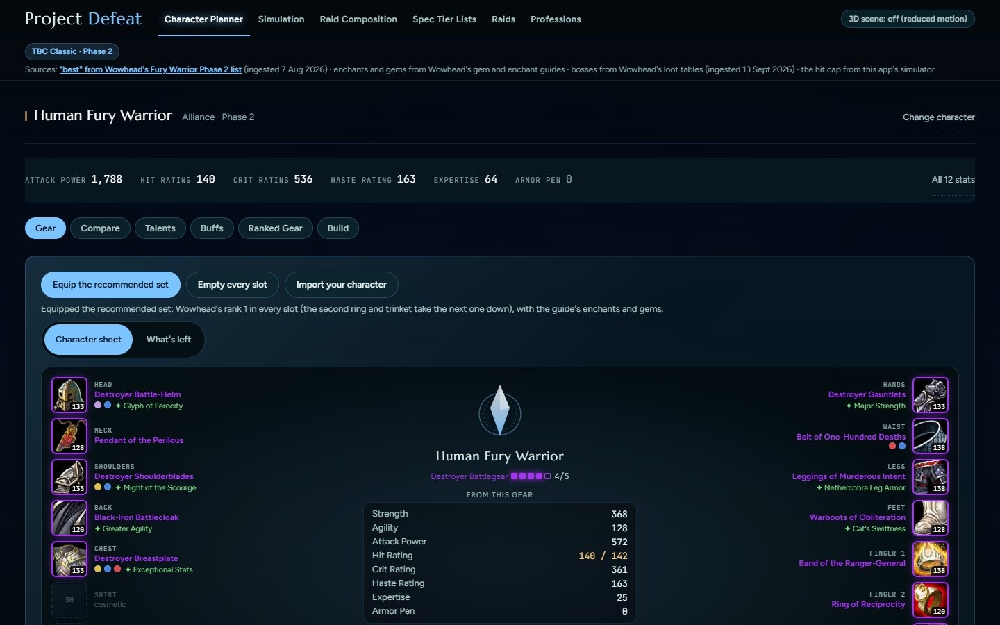

# Project Defeat

A gear / talent / raid comp planner for **World of Warcraft: The Burning Crusade Classic (Anniversary), Phase 2**.

**[Open the live app →](https://josephevenson08.github.io/project-defeat/)**

[](https://github.com/josephevenson08/project-defeat/actions/workflows/deploy.yml)
[](LICENSE)



## What it does

- **Character planner.** Pick a faction, race, class and spec, then fill every slot from real Phase 2 best-in-slot rankings, gems and enchants included, and watch your stats update as you go. Six tabs:
  - **Gear:** the game's character sheet, with your hit cap in plain words and a "What's left" list of one-press fixes.
  - **Ranked Gear:** Wowhead's order for your spec, slot by slot, as game tooltips, and where each item drops.
  - **Compare:** your item's tooltip beside another's, with the trade in one sentence.
  - **Talents:** the game's talent window for all nine classes, a raiding preset where wowsims has one, and what each talent does to your numbers.
  - **Buffs:** filled in from your raid and your seat in it, with consumables.
  - **Build:** a share card and a link that carries the whole build.
- **DPS simulation.** An estimated DPS for the 20 damage specs against a raid boss: your stat priority, your best upgrades with one-press Equip, where the damage comes from, and how far to trust the number.
- **Raid composition.** Seat a 10 or 25-player raid and see which buffs and boss debuffs each group actually gets, what one more seat would add, and who fixes what is missing. You can export the seating chart as an image to show your Discord server what raid night will look like.
- **Raids.** A boss journal for every Phase 1 and 2 raid: each boss's loot with your spec's picks, who in your raid wants each drop, a search across all five raids, and the steps to get attuned.
- **Spec Tier Lists.** Wowhead's tier lists as a board of spec icons, a card for any spec, and a view of those tiers against what players actually parse.
- **Professions.** The game's profession window: set your skill and every recipe on the path to 375 takes its colour, with trainer stops, reagents and each gathering range's loop on its TBC zone map. "Which two" ranks every profession by what it makes for your spec.
- **Import from the game.** A small addon exports your character, so you can open the planner already wearing your gear.
- **Share a build as a link.** Nothing is uploaded; the whole build rides in the URL.



## Using it

Everything runs in your browser. There are no accounts and no server, so there's nothing to sign up for.

1. Open the [live app](https://josephevenson08.github.io/project-defeat/) and choose **Character Planner**.
2. Create your character, or press **Import your character from the game** if you use the addon.
3. Press **Equip the recommended set** to start from the BiS list, then swap pieces from there.

To export your character from the game, see [`addon/README.md`](addon/README.md).

## Where it stands

**Every tab is built for Phase 2.** Each was redesigned and the new designs are all in the live app (October 2026). Since then the work has gone into the simulator's accuracy:

- **It is measured against real players.** Every damage spec's best case is compared with what the top 5% of that spec's players parse in Phase 2 (Warcraft Logs' 95th percentile). The model reads **1.00× to 1.82× below** that, and a test fails if any spec ever reads above it. One exception, Marksmanship, is marked in the app: its comparison comes from too few players of a spec the guides told raiders not to play.
- **What it counts:** your gear, gems, enchants and talents (every talent is either counted, or the app says on screen why it isn't); raid buffs and boss debuffs, each reaching only the spell schools it should; the timed class cooldowns, like Death Wish, Arcane Power and Rapid Fire, averaged over the fight; pets, poisons, bleeds, seals and Windfury.
- **What it doesn't count yet:** cooldowns that empower a single cast (Combustion, Cold Blood and the like), caster mana (which holds Arcane back most), and a few pets. Healer and tank numbers still run but aren't the focus. [Known limitations](docs/known-limitations.md) lists every gap.
- **434 automated tests** run in a real browser, and every dataset comes from a pinned, named source.

**The app stays on Phase 2 on purpose.** The game has since moved on to Black Temple, Mount Hyjal and the Zul'Aman update. Catching up is planned in [`PLAN_FOR_CURRENT_ITERATION.md`](PLAN_FOR_CURRENT_ITERATION.md), which a scheduled job researches every morning. Most of its data work waits on one thing: Wowhead blocks scripted requests, and it is the source for the rankings, loot and tier lists. The same block holds up the refresh of the professions' gathering-node maps.

**Next:** the move to the current content, the simulator's remaining gaps (single-cast cooldowns, caster mana), a search across the whole app (Ctrl K), and the Discord bot below.

## Current dealings

Right now I'm working on making this up to date with TBC, but it's taking a while, so I'll update when I can :D

## Coming next: a Discord bot

A bot that answers questions and requests in Discord from the same data as the app: `/bis fury warrior` for a
spec's BiS list, `/whodrops`, `/loot karazhan`, `/attune`, `/farm fel iron`, and `/import` to list
upgrades from your in-game export. It will run on a Raspberry Pi. See the
[plan](discord-bot/PLAN.md).

## The redesign

Research into how 25 gaming companies and player tools design their sites in 2024–2026
([findings](docs/research/gaming-ui/README.md)) led to clickable [design prototypes](docs/design/prototypes/README.md)
of every tab, walked through one tab at a time, three designs per step, with motion tuned to TBC by
[this research](docs/research/wow-tbc-motion/README.md). Every decided design was brought into the app by the
[port plan](docs/design/PORT-PLAN.md), finished 2026-10-24: the look, Spec Tier Lists, Raids, Professions,
Simulation, Raid Composition, the six planner tabs, and an optional 3D crystal-and-water scene behind every section.
The [prototype gallery](https://josephevenson08.github.io/project-defeat/prototypes/) is still published beside the app.

## Run it locally

Requires Node.js 22 or newer.

```bash
npm install
npm run dev
```

| Command | What it does |
| --- | --- |
| `npm run dev` | Start the dev server |
| `npm run build` | Type-check and build for production |
| `npm run lint` | Run ESLint |
| `npm run test` | Run the Playwright test suite (run `npx playwright install` first) |
| `npm run brain` | Regenerate the Obsidian project notes in `brain/` |
| `npm run changelog` | Regenerate the daily dev log |

**Built with** React, TypeScript, Vite, three.js, Anime.js and Playwright. It deploys to GitHub Pages on every push to `main`.

## Project layout

```
src/          the app (domain data and rules, features, components)
tests/        Playwright tests
tools/        scripts that fetch and prepare game data
public/       icons, maps, raid art and fonts the app ships
addon/        the in-game export addon
discord-bot/  plan for a Discord bot (not built yet)
docs/         everything else: features, roadmap, design notes, research, dev log
brain/        generated Obsidian notes that map the codebase
```

## Docs

- [Full feature list](docs/features.md)
- [Roadmap](docs/ROADMAP.md)
- [Known limitations](docs/known-limitations.md)
- [Plan for the current game content](PLAN_FOR_CURRENT_ITERATION.md)
- [Where the work stands](docs/dev-log/HANDOFF.md): the handoff, read the top to pick the work back up
- [All docs](docs/README.md): architecture, design scopes, a usability study, and the dev log

## License

[MIT](LICENSE). World of Warcraft and its artwork are trademarks of Blizzard Entertainment. This is a fan-made tool and is not affiliated with or endorsed by Blizzard.
